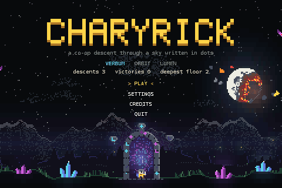
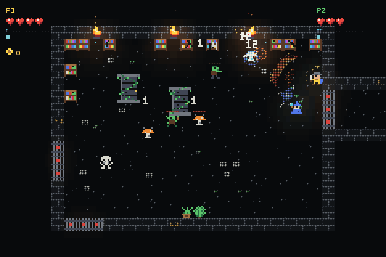
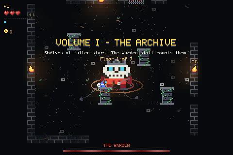
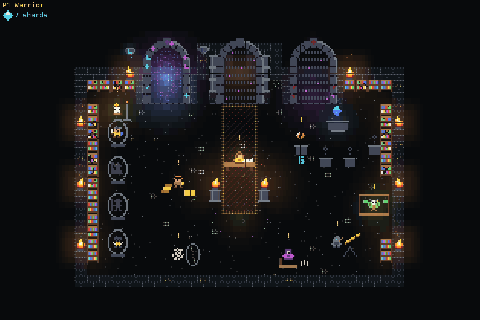
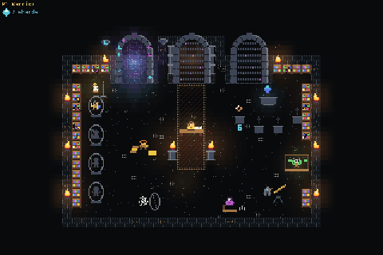

Every dot above is computed by <a href="tools/braille_art.py"><code>tools/braille_art.py</code></a> with CharyRick's palette and 5×7 font — the sky is Conway's Game of Life, played forward and then rewound.

## 🎮 CharyRick

A **real-time co-op roguelike** (up to 4 players on one screen) written from scratch in **C11 + SDL2** and drawn
only with **braille dots and block pixels**. The sky pulses like Conway's Game of Life, something called the
Eraser is eating it, and you are a Reader going down to restore the Glyphs that hold it up.

 
<i>a co-op descent through a sky written in dots</i>

<table>
  <tr>
    <td align="center" width="50%"> <b>Sealed rooms</b> · two heroes, waves of foes, “ROOM CLEARED”</td>
    <td align="center" width="50%"> <b>The Warden</b> · first guardian, bullet rings</td>
  </tr>
  <tr>
    <td align="center"> <b>Portal unlock</b> · runes, the lock bursting, zoom</td>
    <td align="center"> <b>Black hole</b> · leaving the hub</td>
  </tr>
</table>
Recorded straight from the game with the autopilot (<code>--debug-record</code> piped into ffmpeg) — no editing.

### What I built inside it

| | |
|---|---|
| 🧩 **Grade** — my own engine library | braille canvas (each 2×4 block is a cell), pixel fonts with accents, sprites, field of view on a grid, composition layers with z-order, i18n that *fits the text in the box* (wrap → spill → scroll → pages, never shrinking the font) |
| 🔊 **Synth + sequencer** | every sound effect and the music are synthesized in code, no audio files; WAV export for videos |
| 🎲 **Deterministic simulation** | seeded floor generation (4×3 room grids), adaptive difficulty, an **autopilot bot** that plays whole runs — used for tests, balance reports and the GIFs above |
| 🌍 **One game, every platform** | Linux, Windows (MinGW cross-build), macOS (CI build), **Android** (NDK + touch controls with a layout editor) and **EmuELEC** (aarch64 TV console, built in Docker, tested in qemu) |
| 🧪 **Tooling** | CTest suites, headless captures compared byte by byte, a BM25 code search in pure Python, a C/assembly inspector, release packaging with debug tools compiled out |
| 🎬 **Videos** | gameplay, audio and frames exported on the same virtual clock, ready for explainer videos |

~60k lines of C · two languages (English / pt-BR) · Doxygen on every symbol

## ⚙️ Where I live

  

## 🧰 Also in my toolbox

  
  
 

## 📈 Studying now

  

  

<picture>
  <source media="(prefers-color-scheme: dark)" srcset="https://raw.githubusercontent.com/Gabryel-lima/Gabryel-lima/output/github-contribution-grid-snake-dark.svg" />
  <source media="(prefers-color-scheme: light)" srcset="https://raw.githubusercontent.com/Gabryel-lima/Gabryel-lima/output/github-contribution-grid-snake.svg" />
  
</picture>

